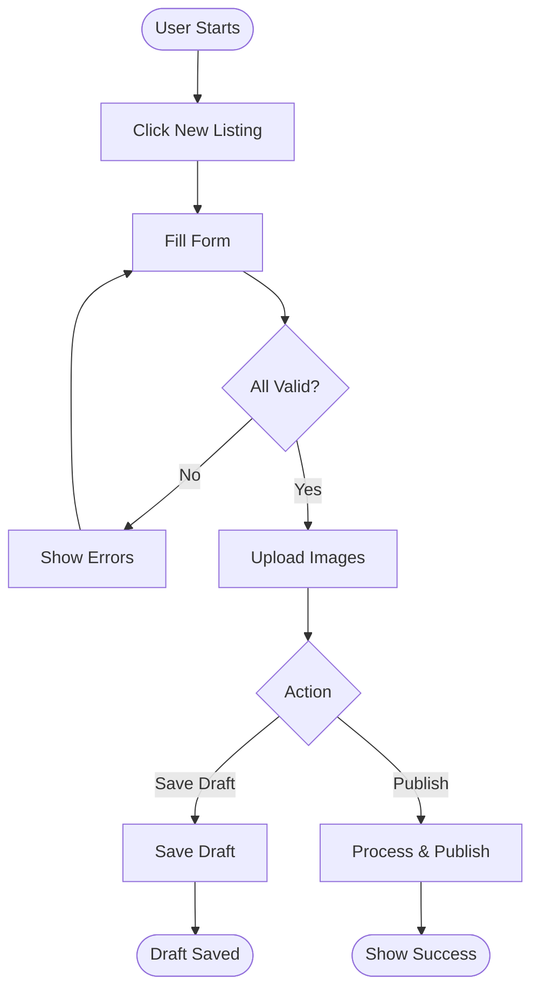
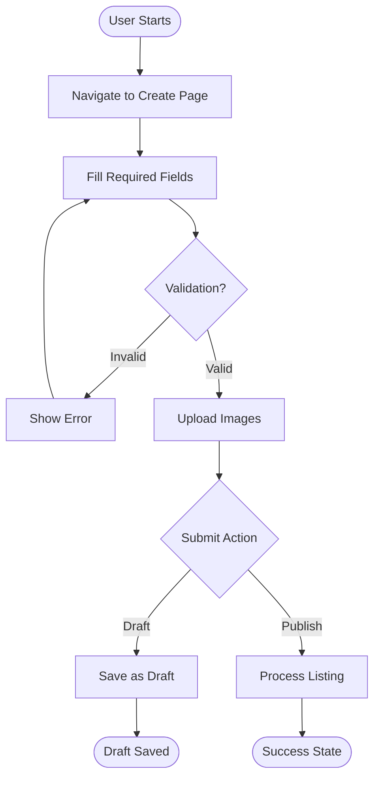
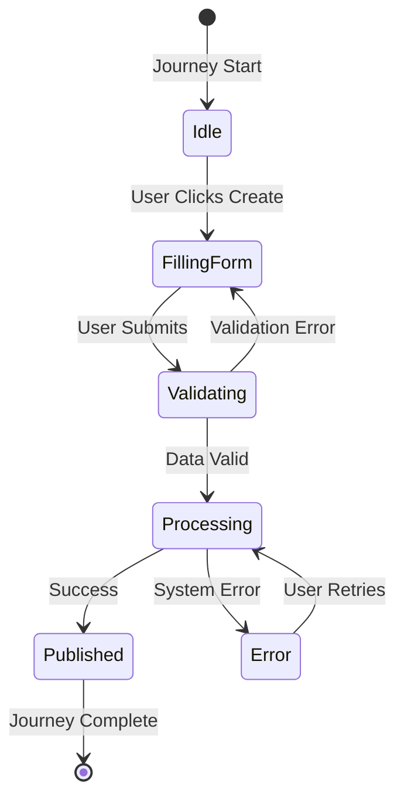
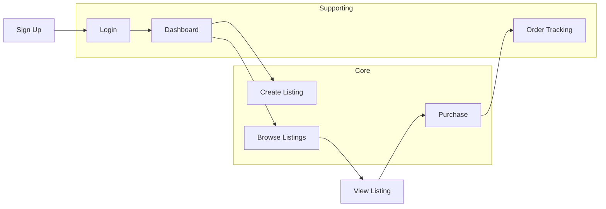

# User Journey Generator Skill

> **Transform business specs into comprehensive journey documentation** — Convert PRDs and requirements into detailed, implementation-ready user journey files.

Product teams write specs, developers build features, but the critical middle step—documenting clear user journeys—is often missing. This skill bridges that gap by transforming raw requirements into structured journey documentation.

---

## Quick Start

```bash
# Generate journeys from a PRD
claude code "create user journeys from docs/product-prd.md"

# From business requirements
claude code "generate journey documentation from specs/business-requirements.md"
```

---

## What It Does

The skill analyzes your business specifications and produces:

- **Structured journey files** with happy paths, alternatives, and edge cases
- **Actor definitions** clarifying user roles and permissions
- **Interactive validation** catching ambiguous requirements upfront
- **Visual Mermaid diagrams** including flowcharts, state diagrams, and relationship maps
- **Cross-journey mappings** showing how flows connect
- **Implementation-ready documentation** teams can use immediately

---

## Example Output

```markdown
## Journey: Create Listing

**Actor:** Registered User
**Goal:** Publish a new listing to the marketplace
**Preconditions:** User is signed in, has completed profile

### Journey Flow Diagram



### Main Path (Happy Path)

1. **Navigate to Create Page**
   - User clicks "New Listing" in navigation
   - System displays listing form

2. **Fill Required Fields**
   - User enters: title, price, description, category
   - System validates each field inline

3. **Upload Images**
   - User selects images from device
   - System uploads and displays previews

4. **Submit Listing**
   - User clicks "Publish"
   - System saves listing and shows success message

### Alternative Paths

**Save as Draft:** User clicks "Save Draft" instead of "Publish"

### Edge Cases

| Error | Trigger | Recovery |
|-------|---------|----------|
| Network timeout | Upload > 30s | Retry button shown |
| Invalid price | Non-numeric | Inline validation error |
```

---

## Features

| Feature | Description |
|--------|-------------|
| PRD Parsing | Extracts features and requirements from structured specs |
| Journey Synthesis | Creates complete user flows from feature descriptions |
| Actor Identification | Determines user roles and personas |
| Interactive Validation | Clarifies ambiguous requirements with user |
| Alternative Paths | Documents edge cases and error scenarios |
| **Mermaid Diagrams** | **Generates visual flowcharts, state diagrams, and relationship maps** |
| Cross-Journey Mapping | Shows connections between related flows |
| Multiple Output Formats | Structured markdown ready for teams |

---

## Installation

### Project-level (recommended)

```bash
mkdir -p .claude/skills
cp -r skills/user-journey .claude/skills/
```

### Global

```bash
cp -r skills/user-journey ~/.claude/skills/
```

---

## Usage

### 1. From Product Requirements (PRD)

```bash
claude code "create user journeys from docs/product-prd.md"
```

Your PRD should contain features, user stories, or requirements:

```markdown
## Features

### Listing Management
- Users can create listings with title, price, description
- System must validate all required fields
- Users receive confirmation after successful submission

### User Authentication
- Users can sign up with email and password
- Users can reset password via email
```

### 2. From Business Requirements

```bash
claude code "generate journey documentation from docs/business-requirements.md"
```

Business requirements are also supported:

```markdown
## Business Requirements

### Core Capabilities
- Sellers must be able to list items for sale
- Buyers must be able to browse and purchase items
- Platform must handle payments securely
```

### 3. Alternative Triggers

```bash
claude code "extract journeys from specs/specs.md"
claude code "document user flows from prd.md"
claude code "map user experiences from requirements.md"
claude code "create UX journey documents from features.md"
```

---

## Input Formats

The skill accepts multiple specification formats:

### Format 1: Structured PRD

```markdown
## Product Requirements Document

### Actors
- Regular User: Can browse and purchase
- Seller: Can create listings
- Admin: Can moderate content

### Features

#### Create Listing
- Users can create listings with required fields
- System validates inputs
- Confirmation shown on success

### User Stories
- As a seller, I want to create listings to sell items
- As a buyer, I want to browse available listings
```

### Format 2: Business Requirements

```markdown
## Business Requirements

### Marketplace Functionality
The platform must enable sellers to list items and buyers to purchase them.

### Key Requirements
- Listings require title, price, and description
- Payment processing must be secure
- Users receive order confirmations
```

### Format 3: Feature Specifications

```markdown
## Feature: User Registration

### Description
New users can register for an account using email and password.

### Requirements
- Email must be unique
- Password must meet complexity requirements
- Verification email sent after registration
```

---

## Output Structure

Generated journey documentation includes:

```markdown
# User Journey Documentation

## Actors & Personas
- Detailed descriptions of each user role
- Goals, permissions, and typical journeys

## Journey Index
- Table of all journeys with metadata
- Complexity, priority, and dependencies

## Journey: [Name]
- Main path (happy path)
- Alternative paths
- Edge cases and error scenarios
- Decision points
- Required data and UI elements
- **Mermaid flow diagram**
- **State transition diagram**

## Cross-Journey Flow Diagram
- **Visual map showing all journey relationships**
- Handoff points between flows

## Validation Notes
- Documented decisions made during generation
- Clarifications provided by user

## Assumptions & Limitations
- Explicit assumptions documented
- Known scope exclusions
```

---

## Interactive Validation

The skill pauses to clarify ambiguous requirements:

### Example Validation Questions

**Actor Clarification:**
> *"For the 'Delete Account' journey, should this be available to users themselves, or only to administrators?"*

**Flow Decision:**
> *"When password reset is requested, should the system send an email link, a temporary password via email, or an SMS code?"*

**Edge Case Handling:**
> *"If a user's payment fails during checkout, should they be redirected to a payment retry page, or shown inline errors?"*

**Success Criteria:**
> *"I'm assuming the 'Create Listing' journey is complete when the user sees a confirmation message. Is this accurate, or should completion be defined differently?"*

### Documented Decisions

All user responses are documented in the output under **Validation Notes**, creating a permanent record of decisions made during journey creation.

---

## Journey Detail Levels

Choose the appropriate detail level:

| Level | Description | Use Case |
|-------|-------------|----------|
| Basic | Happy paths only | Early product planning |
| Detailed | Happy + alternatives | Implementation planning |
| Comprehensive | All paths + edge cases | Full QA and test coverage |

Default: **Detailed**

---

## Visual Diagrams (Mermaid)

The skill automatically generates Mermaid diagrams for each journey. These diagrams render natively in GitHub, GitLab, Notion, and many other markdown-compatible platforms.

### Journey Flow Diagram

Each journey includes a flowchart showing the complete user flow:



### State Transition Diagram

For journeys with multiple states, a state diagram is included:



### Journey Relationship Map

All journeys are connected in a relationship diagram:



### Viewing Diagrams

- **GitHub/GitLab**: Native Mermaid rendering
- **VS Code**: Install Mermaid preview extensions
- **Notion/Confluence**: Copy-paste Mermaid code blocks
- **Export**: Use Mermaid Live Editor for PNG/SVG export

---

## Example: E-commerce Journey

```markdown
## Journey: Complete Purchase

**Actor:** Customer
**Goal:** Complete checkout and pay for items

### Main Path

1. **View Cart**
   - User clicks cart icon
   - System displays items with totals

2. **Enter Shipping Info**
   - User enters address
   - System validates format

3. **Select Payment Method**
   - User chooses payment type
   - System shows payment form

4. **Complete Payment**
   - User submits payment
   - System processes transaction

5. **Receive Confirmation**
   - System shows order confirmation
   - User receives email receipt

### Alternative Paths

**Guest Checkout:** User chooses not to create account
**Save for Later:** User saves cart without purchasing

### Edge Cases

| Error | Trigger | Recovery |
|-------|---------|----------|
| Payment declined | Card fails | Retry with different card |
| Out of stock | Item unavailable | Remove item from cart |
| Shipping error | Invalid address | Correct address fields |
```

---

## Best Practices

### For Input Specs

1. **Be explicit about actors** — Define user roles clearly
2. **List required fields** — Specify what data is needed
3. **Define success** — State what "done" looks like
4. **Consider error cases** — Document what should happen on failure

### For Generated Journeys

1. **Review with stakeholders** — Validate journeys match product vision
2. **Use as implementation guide** — Developers can build directly from journeys
3. **Create test cases** — QA can generate test scenarios from documented paths
4. **Design from journeys** — UX teams can create flows from documented steps
5. **Keep updated** — Regenerate as specs evolve

---

## Use Cases

| Use Case | How It Helps |
|----------|--------------|
| **Product Planning** | Visualize complete user experience before building |
| **Development** | Clear specification of what to implement |
| **QA & Testing** | Comprehensive test scenarios from documented paths |
| **UX Design** | Visual Mermaid flowcharts for user experience mapping |
| **Stakeholder Communication** | Non-technical team members understand flows |
| **Onboarding** | New team members quickly understand user paths |
| **Documentation** | Beautiful diagrams for product documentation |

---

## Comparison: Journey Generator vs. Journey Audit

| Aspect | Journey Generator | Journey Audit |
|--------|------------------|---------------|
| **Purpose** | Create journey documentation | Validate code against journeys |
| **Input** | Business specs / PRDs | Journey specs + codebase |
| **Output** | Journey documentation file | Audit report with gaps |
| **When to Use** | Starting a project | During/after development |
| **Workflow** | Specs → Journeys | Journeys + Code → Report |

**Use both together:** Generate journeys first, then audit implementation against them.

---

## Limitations

- Heuristic-based synthesis from requirements
- Assumptions made during generation are documented
- Quality of output depends on clarity of input specs
- Review by product/UX recommended

---

## When Not to Use

- Very simple, single-action features
- Pure technical documentation (no user interaction)
- As replacement for domain expertise

---

## Tips for Success

1. **Start with clear specs** — Well-organized PRDs produce better journeys
2. **Define actors upfront** — Know who your users are
3. **Think about errors** — Consider what can go wrong
4. **Be specific** — Detail requirements for better synthesis
5. **Iterate interactively** — Use validation questions to refine
6. **Review output** — Stakeholder review improves quality

---

## Roadmap

- HTML/PDF export formats
- Journey template library for common patterns
- Integration with design tools (Figma, Sketch)
- Journey analytics integration
- Additional diagram types (Gantt, ER diagrams)

---

## Contributing

Contributions welcome! Areas for contribution:

1. **New spec format parsers** — Support for additional documentation formats
2. **Journey templates** — Common patterns for different industries
3. **Export formats** — HTML, PDF, JSON output options
4. **Additional diagram types** — Gantt charts, ER diagrams, sequence diagrams

---

## License

MIT License — free to use in your projects!

---

## Acknowledgments

Built for Claude Code — the AI-powered development environment.

**Use Cases:**
- ✅ Product teams documenting feature requirements
- ✅ Developers needing clear implementation specs
- ✅ QA teams generating comprehensive test scenarios
- ✅ UX designers mapping user experiences
- ✅ Stakeholders reviewing product flows
