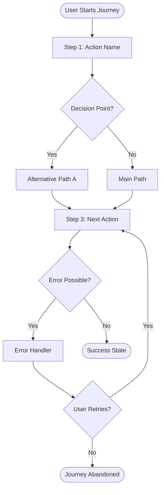
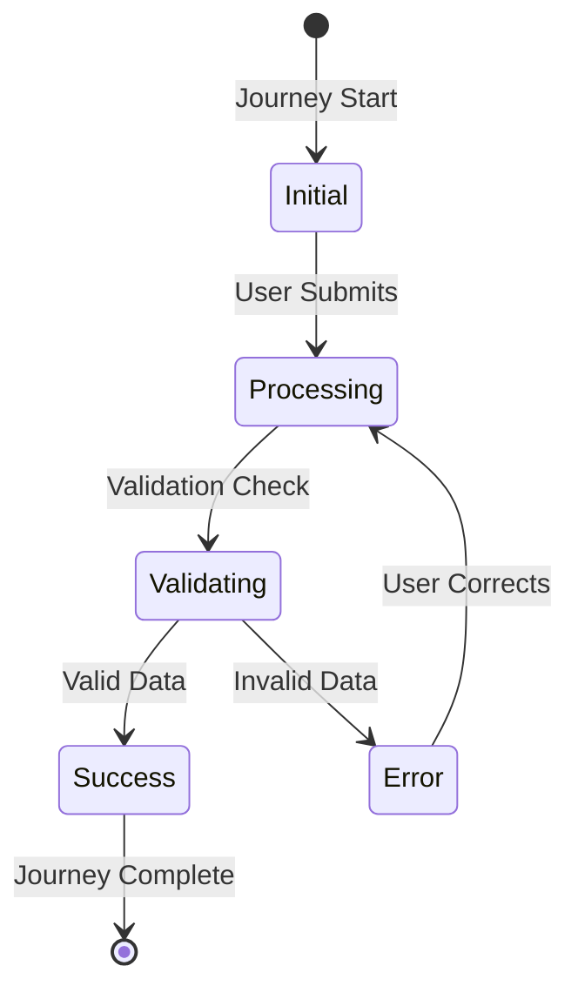
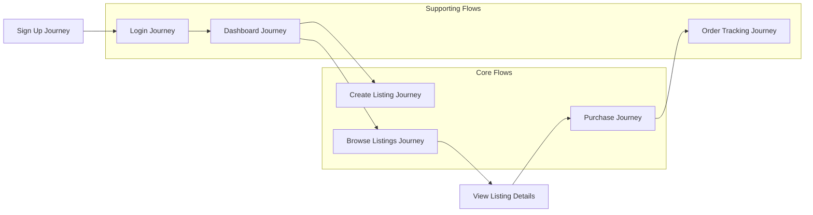
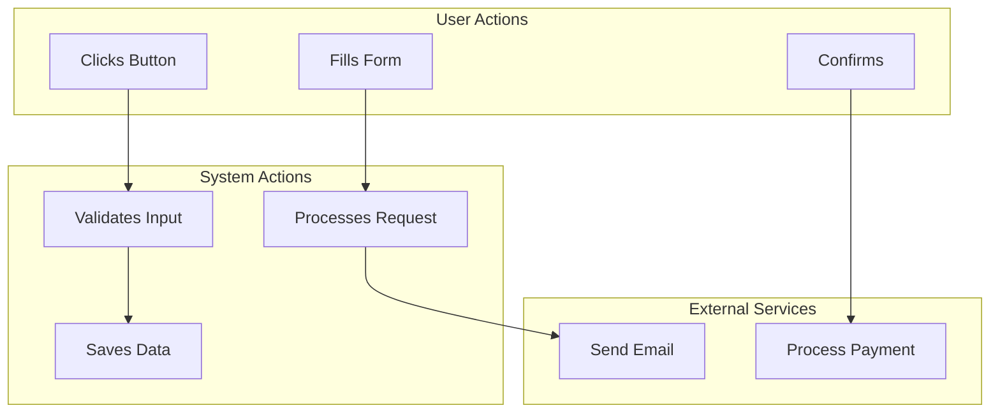
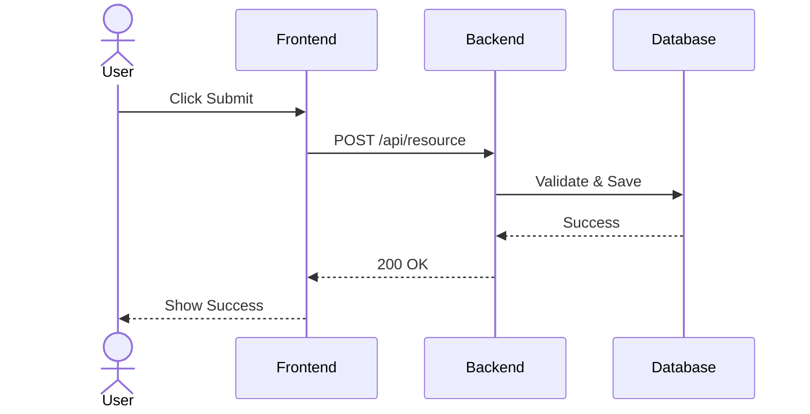

# User Journey Generator Skill

## Overview

This skill transforms raw business specifications, PRDs, or requirement documents into comprehensive, production-ready user journey documentation. It bridges the gap between business requirements and implementation-ready documentation.

**Core Pipeline:**
1. Parse specifications → Extract features, user stories, and requirements
2. Identify actors → Determine user roles and personas
3. Synthesize journeys → Map complete user flows with decision points
4. Interactive validation → Clarify ambiguous requirements with user
5. Document alternatives → Capture edge cases, error paths, and alternative flows
6. Generate diagrams → Create Mermaid flow charts, state diagrams, and relationship maps
7. Generate output → Produce structured journey documentation

---

## Step 1: Parse Specifications

First, read and analyze the specs file provided by the user.

### Identify Specification Type

Determine which format the user provided:

**Type A: Structured PRD**
- Contains sections like `## Features`, `## Requirements`, `## User Stories`
- May include `## Actors`, `## Personas`, or `## User Roles`
- Uses structured lists for requirements
- May have success criteria or acceptance criteria

**Type B: Business Requirements Document**
- Focuses on business goals and objectives
- Describes problems to be solved
- May include stakeholder requirements
- Often less structured from a technical perspective

**Type C: Feature Specifications**
- Detailed descriptions of specific features
- May include technical constraints
- Often has UI/UX descriptions or mockup references

**Type D: Raw Notes or Loose Requirements**
- Unstructured or semi-structured text
- Bullet points of desired capabilities
- May need significant interpretation

### Extract Key Information

For each specification type, extract:

1. **Actors/Personas**: Who is performing the actions?
   - Look for: "User", "Admin", "Customer", "Manager", roles
   - Note any permissions or privilege levels mentioned

2. **Features/Functions**: What can users do?
   - Action verbs: create, read, update, delete, manage, view
   - Entities being acted upon: listings, orders, profiles, etc.

3. **Business Rules**: What constraints exist?
   - Validation rules, permissions, conditions
   - "Must", "should", "required", "optional" keywords

4. **Success Criteria**: What does "done" look like?
   - Explicit acceptance criteria
   - Desired outcomes and deliverables

---

## Step 2: Identify User Journey Candidates

From the extracted information, identify distinct user journeys.

### Journey Detection Heuristics

A journey should be created when:

1. **Primary User Goal**: A user wants to accomplish something specific
   - "Create a listing" → Journey: Create Listing
   - "Reset password" → Journey: Password Reset

2. **Multi-Step Process**: The goal requires multiple actions
   - Not a single click, but a flow
   - Has a beginning, middle, and end

3. **Value-Producing**: The journey delivers value to user or business
   - Not just internal system processes
   - Results in a measurable outcome

### Journey Categorization

Organize journeys into categories:

| Category | Description | Examples |
|----------|-------------|----------|
| Core | Primary value-creating flows | Purchase, Sign Up, Create Content |
| Supporting | Enables core flows | Profile Management, Settings |
| Administrative | Management and oversight | Admin Panel, Moderation |
| Edge Cases | Exception handling | Error Recovery, Cancel Flows |

---

## Step 3: Synthesize Journey Structure

For each journey, create a comprehensive structure.

### Journey Template

```markdown
## Journey: [Journey Name]

**Actor:** [Who performs this journey]
**Goal:** [What the user wants to accomplish]
**Preconditions:** [What must be true before starting]
**Success Criteria:** [What defines completion]

### Main Path (Happy Path)

1. [Step 1]: [Action description]
   - **System Action:** [What the system does]
   - **User Action:** [What the user does]
   - **UI Element:** [What the user interacts with]
   - **Data Required:** [Information needed from user]

2. [Step 2]: [Action description]
   - [...]

### Alternative Paths

**Alt Path 1: [Scenario]**
1. [Where path diverges]
2. [Steps specific to this path]
3. [Where path rejoins main path]

### Edge Cases & Error Scenarios

**Error 1: [Error condition]**
- **Trigger:** [What causes this error]
- **System Response:** [What the system shows]
- **User Recovery:** [How user resolves]

### Decision Points

**Decision 1: [Decision name]**
- **Condition:** [What determines the branch]
- **Option A:** [Path A description]
- **Option B:** [Path B description]
```

### Detailed Journey Synthesis Rules

1. **Start at entry point**: Where does the user begin?
   - Homepage, dashboard, email link, etc.

2. **Follow logical flow**: What happens next?
   - User actions → System responses → Next choices

3. **Identify decision points**: Where can the flow branch?
   - User choices, system conditions, errors

4. **Define completion**: When is the journey "done"?
   - Success state, abandonment, deferral

5. **Consider states**: What state changes occur?
   - Data changes, status updates, notifications

---

## Step 4: Interactive Validation

CRITICAL: Before finalizing journeys, validate with the user for ambiguous requirements.

### When to Trigger Interactive Validation

Trigger validation when:

1. **Ambiguous Actor**: Not clear who performs an action
2. **Unclear Flow**: Multiple possible paths exist
3. **Missing Detail**: Required information not specified
4. **Conflicting Requirements**: Specs contain contradictions
5. **Assumption Needed**: Reasonable interpretation required

### Validation Questions Structure

For each ambiguous point, ask the user:

#### 1. Actor Clarification
> *"For the [Journey Name] journey, who is the primary actor? Should I document this for 'regular users', 'administrators', or both?"*

#### 2. Flow Clarification
> *"In the [Step Name] step, the specs don't specify whether users should [Option A] or [Option B]. Which is the correct flow?"*

#### 3. Data/Field Clarification
> *"For the [Form/Action] step, I'm assuming these fields are required: [list]. Are there additional or different requirements?"*

#### 4. Edge Case Handling
> *"When [error condition] occurs, should the system [response A] or [response B]? The specs don't specify error handling."*

#### 5. Success Criteria Confirmation
> *"I'm interpreting the success of [Journey Name] as [criteria]. Is this accurate, or should success be defined differently?"*

### Documenting User Responses

Record all user clarifications in a validation notes section:

```markdown
## Validation Notes

### [Date/Time] - Actor Clarification
**Question:** Who performs the "Delete Account" journey?
**Answer:** Only users themselves; admins cannot delete user accounts
**Impact:** Updated to single-actor journey

### [Date/Time] - Flow Decision
**Question:** Should password reset use email or SMS?
**Answer:** Email only for now
**Impact:** Documented email-only reset flow
```

---

## Step 5: Document Alternative Paths

Every journey must include alternative paths and edge cases.

### Types of Alternative Paths

1. **User-Initiated Alternatives**
   - User cancels midway
   - User chooses different options
   - User saves for later

2. **System-Initiated Alternatives**
   - System errors (network, database)
   - Validation failures
   - Rate limiting / throttling

3. **Conditional Paths**
   - Different flows for different user roles
   - Location-based variations
   - A/B test variations

4. **Recovery Paths**
   - User recovers from errors
   - User retries failed actions
   - System auto-recovery

### Edge Case Documentation Template

```markdown
### Edge Cases

| Case | Trigger | System Response | User Recovery |
|------|---------|-----------------|---------------|
| Network timeout | No response for 30s | Show retry option | User clicks retry |
| Invalid email format | Email validation fails | Inline error message | User corrects input |
| Duplicate submission | Form submitted twice | Show success once | User navigates away |
```

---

## Step 6: Generate Mermaid Diagrams

Generate visual diagrams using Mermaid syntax for each journey and overall system.

### Diagram Types to Generate

#### 1. Journey Flow Diagram (Flowchart)

Create a flowchart showing the complete user journey including main path, alternatives, and error handling.



**Flowchart Syntax Rules:**
- Use `TD` (top-down) for most journey flows
- Use `LR` (left-right) for linear/sequential flows
- Terminate with `([Name])` for start/end points
- Use `[Name]` for process steps
- Use `{Name}` for decision points
- Use `-->|Label|` for labeled edges

#### 2. State Diagram

Generate a state diagram showing system state transitions throughout the journey.



**State Diagram Syntax Rules:**
- Use `[*]` for start/end states
- Use `-->` for transitions with optional labels
- Group related states together
- Show all possible state transitions

#### 3. Journey Relationship Diagram

Create a high-level diagram showing how journeys connect to each other.



#### 4. Swimlane Diagram

For multi-actor journeys, create a swimlane diagram showing responsibilities.



#### 5. Sequence Diagram

For complex interactions, show the sequence of messages between actors and system.



### Diagram Generation Strategy

For each journey, generate diagrams based on complexity:

| Journey Complexity | Required Diagrams |
|-------------------|-------------------|
| Simple (1-3 steps) | Flow diagram only |
| Medium (4-7 steps) | Flow + State diagrams |
| Complex (8+ steps) | Flow + State + Sequence diagrams |
| Multi-actor | Swimlane diagram required |

### Diagram Naming Convention

```markdown
### Journey Flow Diagram

```mermaid
[Journey Name] Flow Diagram
```

### State Transition Diagram

```mermaid
[Journey Name] State Diagram
```

### Journey Relationships

```mermaid
All Journeys Relationship Map
```
```

### Diagram Best Practices

1. **Keep diagrams readable**: Limit nodes to <20 for clarity
2. **Use clear labels**: Label all edges and decision points
3. **Show alternatives**: Include error paths and edge cases
4. **Color code** (if supported): Use different colors for actors, states, or paths
5. **Group related elements**: Use subgraphs for related components
6. **Maintain consistency**: Use same style across all diagrams

---

## Step 7: Generate Journey Documentation

Output the complete journey documentation in the specified format.

### Output File Structure

```markdown
# User Journey Documentation

**Generated from:** [source file]
**Generated on:** [timestamp]
**Version:** [version]

---

## Table of Contents

- [Actors & Personas](#actors--personas)
- [Journey Index](#journey-index)
- [Journeys](#journeys)
- [Cross-Journey Flows](#cross-journey-flows)
- [Validation Notes](#validation-notes)
- [Assumptions & Limitations](#assumptions--limitations)

---

## Actors & Personas

### [Actor Name]
- **Description:** [Who they are]
- **Goals:** [What they want to accomplish]
- **Permissions:** [What they can/cannot do]
- **Typical Journeys:** [List of journeys they perform]

---

## Journey Index

| Journey | Actor | Complexity | Priority | Dependencies |
|---------|-------|------------|----------|--------------|
| [Journey 1] | [Actor] | [Low/Med/High] | [P0/P1/P2] | [Other journeys] |

---

## Journey: [Journey Name]

**[Complete journey structure from Step 3]**

### Journey Flow Diagram

```mermaid
[Mermaid flowchart for this journey]
```

### State Transition Diagram

```mermaid
[Mermaid state diagram for this journey]
```

---

## Cross-Journey Flow Diagram

```mermaid
[Mermaid diagram showing all journey relationships]
```

### [Flow Name]
**Description:** [How journeys connect]
**Entry Journey:** [Which journey starts this]
**Exit Journey:** [Which journey this leads to]
**Handoff Points:** [Where control transfers]

---

## Validation Notes

**[All validation interactions from Step 4]**

---

## Assumptions & Limitations

### Assumptions
- [List of assumptions made during synthesis]

### Limitations
- [Known limitations or scope exclusions]

### Out of Scope
- [Things explicitly not covered]
```

---

## Framework-Specific Patterns

### E-commerce
- Core: Browse, Search, Add to Cart, Checkout
- Supporting: Account Management, Order Tracking
- Edge: Payment failures, out of stock items

### SaaS Applications
- Core: Onboarding, Core Feature Usage
- Supporting: Settings, Team Management
- Edge: Subscription issues, overages

### Marketplaces
- Core: Create Listing, Browse, Purchase
- Supporting: Messaging, Reviews
- Edge: Disputes, cancellations

### Content Platforms
- Core: Create Content, Discover, Engage
- Supporting: Profile Management, Following
- Edge: Content moderation, copyright

---

## Journey Quality Checklist

Before finalizing, ensure each journey:

- [ ] Has a clear, specific name
- [ ] Identifies the primary actor
- [ ] States the user's goal
- [ ] Lists all preconditions
- [ ] Defines success criteria
- [ ] Documents the happy path completely
- [ ] Includes all major alternative paths
- [ ] Covers error scenarios
- [ ] Identifies decision points
- [ ] Specifies required data/fields
- [ ] Notes relevant UI elements
- [ ] Considers edge cases
- [ ] Includes visual flow diagram
- [ ] Has state transition diagram (for multi-state journeys)

---

## Output Delivery

After generating the documentation:

1. **Write to file:** Save as specified (or default `user-journeys.md`)
2. **Show summary:** Display journey count, actors, and any critical ambiguities resolved
3. **Offer next steps:** Ask if user wants to refine specific journeys, add more detail, or export to different format

---

## Error Handling

If issues occur:

- **Specs file not found:** Ask user to verify path and provide correct file
- **No journeys found:** Explain requirements structure and offer examples
- **Too many journeys:** Offer to merge related journeys or filter by priority
- **Ambiguous specs persist:** Flag unresolved ambiguities and recommend user review

---

## Example Invocation

```bash
# Generate journeys from PRD
claude code "create user journeys from docs/product-prd.md"

# Specify output location
claude code "generate journey documentation from specs.md output to docs/journeys.md"

# Request comprehensive detail
claude code "create comprehensive user journeys from requirements.txt"
```

---

## Tips for Best Results

1. **Start with clear specs**: Well-structured PRDs produce better journeys
2. **Be specific about actors**: Clearly define user roles beforehand
3. **Think in flows**: Consider how journeys connect to each other
4. **Embrace edge cases**: The best journeys handle errors gracefully
5. **Iterate with validation**: Use the interactive validation to refine
6. **Keep journeys focused**: One primary goal per journey

---

## Notes

- Generated journeys are heuristics based on requirements
- Review and refinement by product/UX teams recommended
- Journeys should evolve as products evolve
- Use as foundation for user stories, test cases, and design mockups
